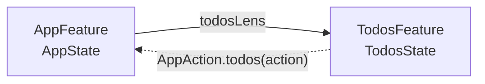
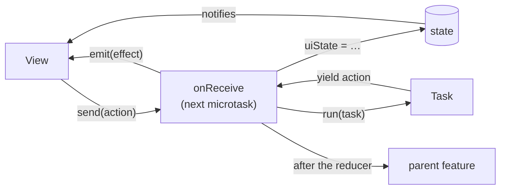

# mvi_dart

A small MVI (Model–View–Intent) core for Flutter.

- **One state tree.** The app state lives in a single root. Each screen gets a slice of it through a `Lens`.
- **Synchronous reducers, cancellable async.** `onReceive` updates state synchronously. Async work runs as a cancellable `Task` that sends actions back.
- **Type-checked composition.** A child scope's lens, action wrapper, and feature are checked against the parent's types at compile time.
- **Exhaustive tests.** `FeatureTester` records every state change, action, and effect, and fails when one goes unasserted.
- **No dependencies.** The core depends only on the Flutter SDK. No code generation.

| Package | What it is |
|---|---|
| [`mvi_dart`](packages/mvi_dart) | The core. Depends on the Flutter SDK only. |
| [`mvi_dart_test`](packages/mvi_dart_test) | `FeatureTester` for unit tests. Add as a `dev_dependency`. |
| [`example`](example) | A todo app using freezed, flutter_hooks, and Riverpod (for DI only). |

## Installation

Requires Dart 3.13+ and Flutter 3.47+. The packages are not on pub.dev. Depend on them through git, pinned to a commit hash.

```yaml
dependencies:
  mvi_dart:
    git:
      url: https://github.com/yu6hooke/mvi_dart.git
      path: packages/mvi_dart
      ref: <full 40-character commit hash of a release tag>

dev_dependencies:
  mvi_dart_test:
    git:
      url: https://github.com/yu6hooke/mvi_dart.git
      path: packages/mvi_dart_test
      ref: <the same commit hash>
```

Use the full commit hash, not a tag or branch name. `mvi_dart_test` depends on `mvi_dart` by a relative path inside this repository, and pub resolves that dependency by commit hash. With a tag or branch in your `pubspec.yaml`, pub sees two different sources for `mvi_dart` and fails.

## Quick start

A feature owns a piece of state and handles actions for it.

```dart
import 'package:flutter/material.dart';
import 'package:mvi_dart/mvi_dart.dart';

sealed class CounterAction {
  const CounterAction();
}

final class Increment extends CounterAction {
  const Increment();
}

final class CounterFeature extends Feature<int, CounterAction, Never> {
  CounterFeature(super.ctx);

  @override
  void onReceive(CounterAction action) {
    switch (action) {
      case Increment():
        uiState = uiState + 1;
    }
  }
}

void main() => runApp(
  RootStore<int, CounterAction, CounterFeature>(
    initial: 0,
    create: CounterFeature.new,
    builder: (context, counter) => MaterialApp(
      home: Scaffold(
        body: Center(
          child: ValueListenableBuilder(valueListenable: counter.state, builder: (_, n, _) => Text('$n')),
        ),
        floatingActionButton: FloatingActionButton(
          onPressed: () => counter.send(const Increment()),
          child: const Icon(Icons.add),
        ),
      ),
    ),
  ),
);
```

- `Feature<S, A, E>` takes the state type, the action type, and the effect type (`Never` when there are none).
- `send` queues the action. Actions are processed on later microtasks, one at a time, in order.
- `feature.state` is a `ValueListenable<S>`, so any Flutter listenable widget or hook can watch it.

## Building a screen

Real apps keep one root state and give each screen its own slice. The examples below use [freezed](https://pub.dev/packages/freezed) for immutable state with `==`. Any immutable value type works.

### 1. Define the contract

```dart
@freezed
abstract class TodosState with _$TodosState {
  const factory TodosState({
    @Default('') String query,
    @Default(<Todo>[]) List<Todo> todos,
    @Default(false) bool loading,
  }) = _TodosState;
}

@freezed
sealed class TodosAction with _$TodosAction {
  const factory TodosAction.queryChanged(String query) = QueryChanged;
  const factory TodosAction.loaded(List<Todo> todos) = Loaded;
  const factory TodosAction.loadFailed(String message) = LoadFailed;
}

@freezed
sealed class TodosEffect with _$TodosEffect {
  const factory TodosEffect.showError(String message) = ShowError;
}
```

### 2. Write the feature

```dart
final class TodosFeature extends Feature<TodosState, TodosAction, TodosEffect> {
  TodosFeature(super.ctx, {required this.repo});

  final TodoRepository repo;

  @override
  void onReceive(TodosAction action) {
    switch (action) {
      case QueryChanged(:final query):
        uiState = uiState.copyWith(query: query, loading: true);
        run(id: #search, (life) async* {
          try {
            await life.delay(const Duration(milliseconds: 300));
            yield TodosAction.loaded(await life.guard(repo.search(query)));
          } on Cancelled {
            rethrow;
          } catch (_) {
            yield const TodosAction.loadFailed('Could not load');
          }
        });
      case Loaded(:final todos):
        uiState = uiState.copyWith(todos: todos, loading: false);
      case LoadFailed(:final message):
        uiState = uiState.copyWith(loading: false);
        emit(TodosEffect.showError(message));
    }
  }
}
```

- Read and write state with `uiState`. A write is visible to the next read right away.
- Dependencies come in through the constructor.

### 3. Mount it under the root

The root feature holds the whole app state. A child scope projects a slice of it with a `Lens` and wraps the child's actions into a parent action.

```dart
@freezed
abstract class AppState with _$AppState {
  const factory AppState({@Default(TodosState()) TodosState todos}) = _AppState;
}

@freezed
sealed class AppAction with _$AppAction {
  const factory AppAction.todos(TodosAction action) = AppTodos;
}

final todosLens = Lens<AppState, TodosState>(get: (s) => s.todos, set: (s, t) => s.copyWith(todos: t));

final class AppFeature extends Feature<AppState, AppAction, Never> {
  AppFeature(super.ctx);

  @override
  void onReceive(AppAction action) {
    // Child actions arrive here after the child reducer has run. React to them or ignore them.
  }
}

// Above MaterialApp, so pushed routes and dialogs can see the root.
final app = RootStore<AppState, AppAction, AppFeature>(
  initial: const AppState(),
  create: AppFeature.new,
  builder: (context, app) => const MaterialApp(home: TodosPage()),
);

class TodosPage extends StatelessWidget {
  const TodosPage({super.key});

  @override
  Widget build(BuildContext context) => context.feature<AppFeature>().scope(
    lens: todosLens,
    wrapAction: AppAction.todos,
    create: (ctx) => TodosFeature(ctx, repo: TodoRepository()),
    builder: (context, todos) => TodosView(todos),
  );
}
```



- The child does not copy its state. Every read goes through the lens to the root, and every write goes back through `Lens.set`.
- Scopes nest: call `todos.scope(...)` inside the child for a grandchild.
- `context.feature<F>()` finds the nearest enclosing feature of type `F`.

### 4. Build the view

```dart
class TodosView extends StatelessWidget {
  const TodosView(this.todos, {super.key});
  final TodosFeature todos;

  @override
  Widget build(BuildContext context) => EffectListener<TodosEffect>(
    todos,
    onEffect: (context, effect) => switch (effect) {
      ShowError(:final message) => ScaffoldMessenger.of(context).showSnackBar(SnackBar(content: Text(message))),
    },
    child: Column(
      children: [
        TextField(onChanged: (q) => todos.send(TodosAction.queryChanged(q))),
        Select(
          todos.state,
          selector: (s) => s.loading,
          builder: (_, loading) => loading ? const LinearProgressIndicator() : const SizedBox.shrink(),
        ),
        Expanded(
          child: Select(
            todos.state,
            selector: (s) => s.todos,
            builder: (_, list) => ListView(children: [for (final t in list) ListTile(title: Text(t.title))]),
          ),
        ),
      ],
    ),
  );
}
```

- `Select` rebuilds only when the selected value changes (by `==`).
- `EffectListener` delivers effects after the current frame, so navigating or showing a SnackBar is safe.

## Async work

Reducers stay synchronous. Anything that waits goes into `run`.

```dart
run(id: #search, (life) async* {
  await life.delay(const Duration(milliseconds: 300)); // debounce
  final results = await life.guard(repo.search(query));
  yield TodosAction.loaded(results);
});
```

A task is a function from a `Lifetime` to a stream of actions. Each yielded action is sent back to the feature.

| Need | Write |
|---|---|
| Keep only the latest run | Give it an `id`. A new run with the same id cancels the old one. |
| Cancel explicitly | `cancel(#search)` |
| Wait in a cancellable way | `await life.delay(d)` |
| Stop waiting on a future when cancelled | `await life.guard(future)` |
| Also cancel the underlying work | `life.onCancel(token.cancel)` |
| Ignore a repeat while one is running | Check state in the reducer and skip `run`: `case Submit() when uiState.submitting: return;` |

When a task is cancelled, the `async*` body stops at its current `await` or `yield`, its `finally` blocks run, and it sends nothing more. Inside the task, a cancelled `guard` or `delay` throws `Cancelled`. Disposing the feature cancels all of its tasks.

A cancelled task never sends its completion action. Reset "in progress" flags in the reducer that starts the replacement, not only in the completion handler.

## Effects

Effects are one-off events for the view, such as navigation, SnackBars, or opening a URL. They are not part of state.

```dart
emit(TodosEffect.showError('Could not load'));
```

Two equal effects in a row are both delivered. An effect emitted before the view starts listening is held and delivered once a listener attaches.

## Sharing state

**Between a parent and a child**, put the value in the parent's state and project it through the lens.

**Between screens that are not ancestors of each other**, use a `SharedKey`. Each `RootStore` holds its own values, so nothing is global.

```dart
final remainingCount = SharedKey<int>('remainingCount', 0); // top-level final

// In a feature:
late final remaining = shared(remainingCount); // Shared<int>
remaining.value = 3;
remaining.update((v) => v + 1);

// In a widget:
Select(context.sharedStore(remainingCount), selector: (v) => v, builder: (_, v) => Text('$v left'));
```

To keep an outside value in sync with your state, use `combineWith` in the constructor. It merges once right away and again on every change.

```dart
SummaryFeature(super.ctx) {
  combineWith(shared(remainingCount), (s, v) => s.copyWith(remaining: v));
}
```

## Testing

`FeatureTester` runs a feature without widgets, on fake time. It records everything the feature does. The test asserts each event in order, and anything left unasserted fails the test.

```dart
import 'package:mvi_dart_test/mvi_dart_test.dart';

test('search waits 300ms', () => fakeAsync((fa) {
  final h = FeatureTester(fa, const TodosState(), (ctx) => TodosFeature(ctx, repo: FakeRepo()));

  h.send(const TodosAction.queryChanged('milk'), (s) => s.copyWith(query: 'milk', loading: true));
  h.advance(const Duration(milliseconds: 400));
  h.receive(TodosAction.loaded(milk), (s) => s.copyWith(todos: milk, loading: false));
}));
```

| Method | What it does |
|---|---|
| `send(action, [expected])` | Sends an action. Fails if earlier events are still unasserted. Optionally checks the resulting state. |
| `receive(action, [expected])` | Asserts the next event is `action`, sent back by a task. Optionally checks the resulting state. |
| `expectEffect(effect)` | Asserts the next event is this effect. |
| `expectShared(key, prev, next)` | Asserts the next event is this shared-value change. Requires `trackShared: [key]` in the constructor. |
| `expectState(expected)` | Asserts state changes that no action caused, such as from `combineWith`. |
| `advance(duration)` | Moves fake time forward. |
| `skipUnasserted(reason)` | Discards pending events on purpose. |

At the end of the test, `FeatureTester` also fails if any task is still running or any timer or microtask is pending.

## Using with hooks and DI

The core does not depend on either. State is a `ValueListenable`, so two small hooks cover flutter_hooks:

```dart
T useSelect<S, T>(ValueListenable<S> state, T Function(S s) selector) =>
    useListenableSelector(state, () => selector(state.value));

void useEffects<E>(Feature<Object?, Object?, E> feature, void Function(E effect) onEffect) {
  final context = useContext();
  final latest = useRef(onEffect)..value = onEffect;
  useEffect(() => listenEffects<E>(feature, () => context.mounted, (e) => latest.value(e)), [feature]);
}
```

For dependency injection, pass dependencies into the feature constructor in `create`. With Riverpod as the container:

```dart
extension ReadProvider on BuildContext {
  T read<T>(Provider<T> provider) => ProviderScope.containerOf(this, listen: false).read(provider);
}

parent.scope(
  lens: todosLens,
  wrapAction: AppAction.todos,
  create: (ctx) => TodosFeature(ctx, repo: context.read(todoRepositoryProvider)),
  builder: (context, todos) => TodosView(todos),
);
```

Use plain `Provider<T>`, not autoDispose providers. A one-time read does not keep an autoDispose provider alive, so it could be disposed while the feature still uses it.

See [`example/`](example) for a complete app.

## Rules

- **`onReceive` is synchronous.** Never mark it `async`. Put waiting in `run`.
- **State is immutable and compares by value.** Use freezed or write `==`. A record holding a `List` compares the list by identity, so avoid it.
- **`SharedKey`s are top-level `final`s.** They cannot be `const`.
- **`RootStore` goes above `MaterialApp`.** Otherwise pushed routes and dialogs cannot see the root or shared values.

## How it works



- `send` schedules the action as a microtask. Microtasks run one at a time in order, so ordering, re-entrant sends from a reducer, and sends during build need no extra queue.
- If a reducer throws, its state changes are rolled back and the action is not forwarded to the parent.
- A child's action reaches the parent only after the child's reducer has run.

## License

[MIT](LICENSE)
